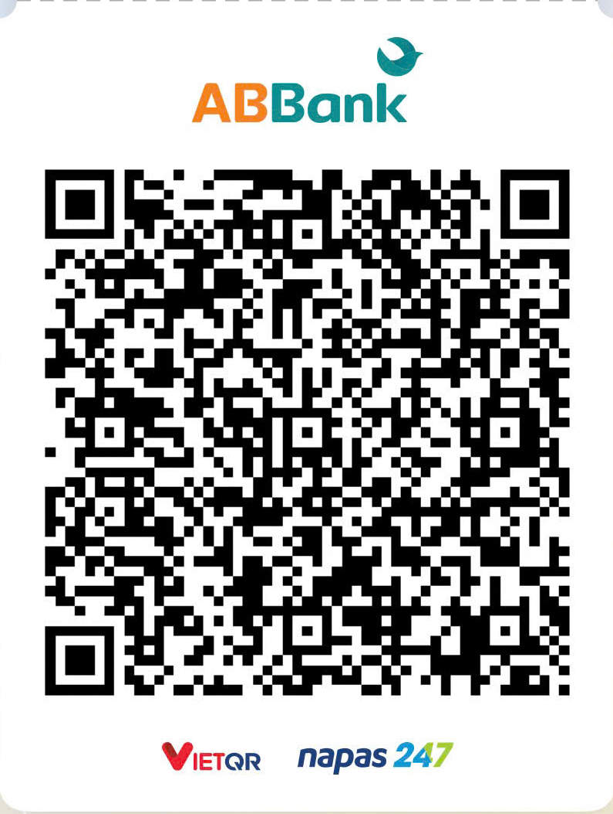

# BBI Legend TV

Bộ công cụ cá nhân hóa **Android TV / Google TV** của BBI MEDIA phát triển thêm từ repo cơ bản Free My TV: kiểm tra thiết bị, cài giao diện **Free My TV, Windows XP, XP Widgets, Vista và macOS**, sao lưu / khôi phục, quản lý ứng dụng và thiết lập các tiện ích cho remote.

Giao diện tiếng Việt, chạy trên máy tính tại `http://127.0.0.1:8765`. Có file khởi chạy cho **Windows, Linux và macOS**; Windows đã được kiểm tra thực tế.

## Tính năng

- **Hướng dẫn bằng hình:** từng bước bật chế độ nhà phát triển, gỡ lỗi USB, lấy địa chỉ IP và cho phép máy tính kết nối với TV.
- **Kết nối & kiểm tra:** đọc model, phiên bản Android, kiểm tra khả năng hỗ trợ; kết nối ADB trong mạng nội bộ và ghép nối bằng mã 6 số.
- **Kho giao diện:** Free My TV mặc định, Windows XP, XP Widgets, Vista và macOS trong cùng một APK đã ký; đổi phong cách ngay từ công cụ.
- **Sao lưu & khôi phục:** tự tạo backup trước khi thay đổi, có sao lưu thủ công; kiểm tra SHA-256 và chỉ khôi phục về đúng TV đã tạo bản sao.
- **Home 3 lần:** nhấn Home liên tục 3 lần để đóng hẳn ứng dụng vừa dùng; bảo vệ launcher, bàn phím và dịch vụ hệ thống.
- **Cài đặt nhanh:** âm thanh điều hướng, thành phố và đơn vị nhiệt độ, thời tiết / crypto trên theme mặc định, ngày giờ tự động; mở cài đặt mạng và Trợ năng trên TV.
- **Quản lý ứng dụng:** xem ứng dụng đang mở / chạy nền, RAM ước lượng và chụp màn hình TV.
- **Giới thiệu & cập nhật:** thông tin BBI MEDIA, cộng đồng, donate và nhật ký phiên bản riêng của BBI Legend TV.

## Tải bản portable (cách nhanh nhất)

Vào [Releases](https://github.com/bbimedia/BBI-Legend-TV/releases/latest), tải `BBI-Legend-TV-v….zip` ở mục **Assets** rồi giải nén toàn bộ thư mục.

Cần cài **[Python 3.10 trở lên](https://www.python.org/downloads/)**. Trên Windows, chọn **Add Python to PATH** khi cài Python.

| Hệ điều hành | Mở ứng dụng |
|---|---|
| Windows | Nhấp đúp `start-windows.cmd` |
| macOS | Mở `start-macos.command`, hoặc chạy `bash start.sh` trong Terminal |
| Linux | Chạy `bash start.sh` trong Terminal |

Trình duyệt tự mở `http://127.0.0.1:8765`. Giữ cửa sổ khởi chạy mở trong lúc dùng; nhấn **Ctrl+C** để dừng.

Bản ZIP kèm Android Platform Tools cho Windows. Trên Linux/macOS, chọn **Chuẩn bị công cụ** để tải gói từ Google ở lần đầu. Nếu đã có ADB trong PATH, ứng dụng tự sử dụng bản đó.

## Chạy từ mã nguồn

### Yêu cầu

- Python **3.10+**; backend dùng thư viện chuẩn, không cần cài thêm gói Python.
- Trình duyệt web trên máy tính.
- TV chạy **Android TV / Google TV, Android 9 trở lên**, cho phép bật ADB.
- Máy tính và TV ở cùng mạng nội bộ, có thể truy cập nhau.
- Android Platform Tools: dùng ADB có sẵn trong PATH hoặc chọn **Chuẩn bị công cụ** trong giao diện.

### Cài đặt

```bash
git clone https://github.com/bbimedia/BBI-Legend-TV.git
cd BBI-Legend-TV
```

### Chạy

Trên Windows, mở `start-windows.cmd` hoặc chạy:

```powershell
py -3 server.py
```

Trên Linux/macOS:

```bash
python3 server.py
```

Trình duyệt tự mở `http://127.0.0.1:8765`. Dữ liệu, ảnh chụp và backup nằm trong thư mục `data/`, được tạo khi sử dụng và không đưa lên Git.

Nếu cổng đã được dùng, thêm `--port 8766`. Để tự mở trình duyệt thủ công, thêm `--no-browser`. Có thể chỉ định ADB qua `--adb /duong/dan/adb` hoặc biến môi trường `TVMOD_ADB`.

### Phát triển giao diện

Sửa trực tiếp HTML, CSS và JavaScript trong `public/`, sau đó tải lại trang. Giao diện không có bước build và không cần Node.js.

Mã nguồn launcher Android nằm trong `launcher-source/`. APK dùng sẵn nằm trong `packages/FreeMyTV-Studio.apk`; thay đổi giao diện web không cần build lại APK.

### Kiểm tra và đóng gói

```bash
python -m unittest discover -s tests -v
python tools/package_portable.py
```

Công cụ đóng gói tạo ZIP và file SHA-256 ở thư mục cha, loại dữ liệu máy phát triển, backup và khóa riêng. Xem [TESTING.md](TESTING.md) để biết phạm vi kiểm tra.

## Miễn trừ trách nhiệm và quyền sở hữu

BBI Legend TV được cung cấp theo hiện trạng, không bảo đảm phù hợp với mọi thiết bị. Model, firmware, phiên bản Android, remote và cấu hình mạng có thể tạo ra kết quả khác nhau. Người dùng cần kiểm tra tương thích, đọc hướng dẫn và sao lưu trước khi thay đổi. Backup của công cụ không phải bản sao toàn bộ hệ thống và không bảo đảm khôi phục mọi lỗi.

Trong phạm vi pháp luật cho phép và theo giấy phép MIT, tác giả không bảo đảm phần mềm không có lỗi và không chịu trách nhiệm đối với thiệt hại phát sinh từ việc sử dụng hoặc không thể sử dụng phần mềm. Nội dung này không loại trừ các quyền và trách nhiệm bắt buộc theo pháp luật áp dụng.

Các giao diện XP, Vista và macOS là mẫu tùy biến lấy cảm hứng để tham khảo; không phải sản phẩm chính thức của Microsoft hoặc Apple và không thể hiện quan hệ liên kết, tài trợ hay bảo trợ. Tên gọi, nhãn hiệu, biểu tượng, hình nền và hình ảnh của bên thứ ba vẫn thuộc chủ sở hữu tương ứng. Giấy phép MIT của dự án không cấp quyền sử dụng các tài sản đó ngoài quyền mà chủ sở hữu cho phép. Việc gọi một giao diện là “tham khảo” không tự tạo ra quyền sử dụng hay miễn trừ nghĩa vụ bản quyền. Người dùng cần có quyền phù hợp khi sử dụng, sửa đổi hoặc phân phối lại tài sản của bên thứ ba.

Nếu phát hiện tài sản có vấn đề về quyền sử dụng, vui lòng gửi đường dẫn, mô tả và bằng chứng quyền sở hữu tới **info@bbimedia.vn** để BBI MEDIA xem xét, thay thế hoặc gỡ bỏ khi cần.

## Lưu ý

- **Thiết bị hỗ trợ:** Hỗ trợ hầu hết các dòng Android TV (Google TV) hiện nay. Đã thử với Xiaomi MiTV-MOOR2 / Android 11. Khả năng tương thích còn phụ thuộc firmware và remote. TV chạy webOS hoặc Tizen không thuộc phạm vi công cụ này. Linux/macOS có file khởi chạy nhưng chưa chạy thực tế trên từng hệ điều hành; Linux ARM cần ADB phù hợp kiến trúc qua PATH hoặc `--adb`.
- **Lần đầu cài:** trên TV, chọn **Free My TV → Home Screen → BBI Legend TV** và chấp nhận yêu cầu gỡ lỗi. Để về giao diện gốc, chọn **Home Screen → Original** trước khi gỡ Free My TV.
- **Home 3 lần:** cần ADB cổng 5555 và dịch vụ Trợ năng **BBI Legend TV — Đóng ứng dụng**. Khi bật tùy chọn và lưu/cài, công cụ bật dịch vụ này, giữ các dịch vụ Trợ năng khác. Buộc dừng sẽ ngắt phát nội dung và tác vụ nền của app cho đến khi mở lại.
- **Backup:** lưu APK và các tùy chọn mà BBI Legend TV quản lý khi launcher hỗ trợ xuất cài đặt. Không bao gồm firmware, tài khoản, Wi-Fi hay dữ liệu các app khác; không sao lưu toàn bộ ánh xạ remote hoặc dữ liệu riêng của launcher. Bản launcher cũ không hỗ trợ xuất cài đặt chỉ được sao lưu APK. Giữ toàn bộ `data/backups/` khi chuyển sang máy khác.
- **Khôi phục:** không xóa dữ liệu hoặc gỡ Free My TV trước khi restore. Công cụ kiểm tra đúng TV, kiểm tra toàn vẹn và tạo bản dự phòng trước khi khôi phục; nếu khác chữ ký APK sẽ dừng.
- **Giao diện:** XP, Vista và macOS là các phong cách lấy cảm hứng, không cài hệ điều hành tương ứng lên TV. Gợi ý phim trên theme mặc định cần bản build có khóa TMDB riêng.
- **Kết nối:** API chỉ chấp nhận IP LAN thuộc các dải `10.x`, `172.16–31.x`, `192.168.x`. ADB ghép nối cổng động cần chuyển sang cổng 5555 để cơ chế tự kết nối của Free My TV hoạt động.
- **Dữ liệu:** máy chủ chỉ lắng nghe `127.0.0.1`, kiểm tra token phiên và Host/Origin. Mã ghép nối chỉ giữ tạm trong bộ nhớ. Không đưa khóa ADB, khóa ký APK hoặc backup cá nhân lên repo.

## XP Widgets — màn hình thông tin phong cách XP

Theme **XP Widgets** được thêm riêng, giữ theme XP cổ điển. Trong **Kho giao diện**, chọn **XP Widgets** rồi **Cài giao diện đã chọn** để cập nhật APK có theme mới. Nếu TV đã có APK 1.3-widgets, có thể dùng **Chỉ đổi theme**. Sau khi cài, widget chạy trực tiếp trên TV; không cần giữ máy tính mở.

- **Bố cục:** cột ứng dụng bên trái, sáu cửa sổ XP cho đồng hồ, thời tiết, lịch, bóng đá, vàng và chứng khoán; thanh Start ở dưới. Dùng remote để chọn, nhấn OK xem chi tiết; Back/Menu mở danh sách app.
- **Thời gian & lịch:** giờ Việt Nam UTC+7, lịch dương theo tháng và lịch âm Việt Nam tính trên TV (1900–2099, có tháng nhuận). Nhấn OK vào lịch để xem từng ngày âm/dương, chuyển tháng.
- **Thời tiết:** Open-Meteo, theo thành phố và đơn vị nhiệt độ đã chọn; làm mới khoảng 30 phút. Công tắc thời tiết cũng áp dụng cho XP Widgets.
- **Bóng đá:** Hôm nay / 7 ngày tới, crawl từ [lịch Bongda24h](https://bongda24h.vn/bong-da/lich-thi-dau.html) và các phần lịch theo ngày mà chính trang này tải. Ưu tiên đội tuyển Việt Nam nam/nữ, V.League 1; tiếp theo Ngoại hạng Anh, Champions League (C1), Serie A, La Liga và Bundesliga. Có bộ lọc từng giải và liên kết lịch gốc/VPF/VFF. Làm mới khoảng 30 phút, có nút làm mới thủ công; lần tải thiếu ngày thử lại khoảng 5 phút. Không thực thi script hoặc tải hình ảnh/quảng cáo của trang.
- **Kênh phát tại Việt Nam:** lấy nguyên tên kênh từ từng trận trên Bongda24h cùng giờ thi đấu theo Việt Nam; không cộng thêm 7 giờ và không suy đoán theo đơn vị giữ bản quyền. Thiếu kênh ghi **Chưa có thông tin kênh tại Việt Nam**. Không cung cấp luồng phát. Độ đầy đủ phụ thuộc trang nguồn; lịch đội tuyển chỉ hiện khi có trận trong dữ liệu. Nếu trang đổi cấu trúc/lỗi mạng, giữ bản lưu và báo trạng thái thay vì coi là lịch trống.
- **Giá vàng:** vàng miếng SJC do DOJI công bố, qua feed mở taichinh.com; hiển thị mua/bán theo triệu đồng/lượng và mốc công bố riêng. Biểu đồ giá bán tích lũy các mốc thực nhận trên TV (tối đa 30 ngày/240 điểm), cần ít nhất hai mốc để vẽ; không phải lịch sử thị trường đầy đủ. Làm mới khoảng 15 phút.
- **Chứng khoán Việt Nam:** chọn VNINDEX, VN30, FPT, VCB, HPG. Nguồn DNSE/Entrade Chart API, biểu đồ giá đóng cửa theo phiên; chỉ số tính bằng điểm, cổ phiếu nghìn đồng; phần trăm so với phiên trước trong chuỗi. Hiển thị rõ ngày phiên, không phải bảng điện trực tiếp. Làm mới khoảng 15 phút.
- **Khi mất mạng:** giữ bản lưu nếu có và ghi trạng thái; không tạo số liệu mẫu. Đồng hồ/lịch vẫn hoạt động. Giá có thể trễ và chỉ dùng tham khảo, không phải khuyến nghị đầu tư. Lịch/kênh có thể thay đổi, nên đối chiếu đơn vị phát sóng trước giờ đấu.

Ảnh XP Widgets trong kho giao diện là minh họa bố cục, dùng dấu `--` ở các mục cần dữ liệu mạng. Dữ liệu widget và đường giá tích lũy lưu cục bộ trên TV, không nằm trong gói backup tùy chọn của công cụ. Các nguồn mạng nhận kết nối thông thường từ TV; Open-Meteo nhận tọa độ thành phố đã chọn.

Nguồn và tài liệu: [Open-Meteo](https://open-meteo.com/en/docs), [Lịch Bongda24h](https://bongda24h.vn/bong-da/lich-thi-dau.html), [taichinh.com API](https://taichinh.com/api), [DNSE](https://www.dnse.com.vn/). Các endpoint có thể thay đổi hoặc giới hạn truy cập; giấy phép của dự án không cấp thêm quyền với dữ liệu của nhà cung cấp.

## Nhận diện trên launcher

Tên ứng dụng, logo trong cài đặt, lựa chọn màn hình Home và nhãn dịch vụ mang thương hiệu **BBI Legend TV / BBI MEDIA**. Nền cài đặt đồng bộ với theme màn hình chính; cột trái có VietQR và thông tin ủng hộ BBI MEDIA. Cuối màn hình ghi `Mã nguồn gốc: @free-my-tv - MIT - Phát triển: BBIMedia.VN`, bên dưới là miễn trừ trách nhiệm về tương thích, dữ liệu tham khảo và quyền hình ảnh/nhãn hiệu. Giữ nguyên package/component Android để cập nhật cùng chữ ký và giữ dữ liệu; các file giấy phép và ghi công nguồn gốc vẫn có trong repo.

## Thông báo phiên bản mới

Ứng dụng kiểm tra bản Release ổn định mới nhất tại repo BBI Legend TV khi mở, tối đa một lần mỗi 24 giờ, và kiểm tra lại khi đang mở lâu. Có nút **Kiểm tra cập nhật** và công tắc tự kiểm tra trong **Cài đặt nhanh**. Khi có bản mới, thông báo có liên kết xem thay đổi / tải xuống và nút Để sau. Không tự tải hoặc cài đặt. Push code thông thường không kích hoạt thông báo; cần phát hành GitHub Release mới.

Kiểm tra cập nhật kết nối trực tiếp tới API GitHub công khai, không gửi IP TV, backup hoặc tài khoản TV; GitHub vẫn nhận thông tin kết nối Internet thông thường. Có thể tắt tự kiểm tra. Mất mạng hoặc GitHub giới hạn truy cập không ảnh hưởng chức năng TV. Tùy chọn và thời điểm kiểm tra lưu trong trình duyệt đang dùng.

## Cộng đồng

Tham gia nhóm **Tôi là Vibe'r** để hỏi đáp, góp ý và chia sẻ kinh nghiệm:

- [Nhóm Zalo](https://zalo.me/g/lz86cu6fnk7orfml6mmk)
- [Nhóm Facebook](https://www.facebook.com/groups/toilaviber)

## Special Thanks

BBI Legend TV phát triển từ Free My TV và sử dụng các công cụ, tài nguyên mã nguồn mở. Cảm ơn các tác giả:

- **Launcher Android TV:** [Free My TV](https://github.com/simbasjungles/free-my-tv) — mã nguồn MIT, nền tảng launcher và cơ chế khôi phục.
- **Kết nối thiết bị:** [Android Platform Tools](https://developer.android.com/tools/releases/platform-tools) — ADB chính thức của Google.
- **Dịch vụ web cục bộ:** [Python](https://www.python.org/).
- **Phông chữ & biểu tượng:** [Inter](https://rsms.me/inter/) — SIL OFL; [Material Symbols](https://fonts.google.com/icons) — Apache-2.0.

## Ủng hộ dự án

Phần mềm miễn phí và mã nguồn mở. Nếu thấy hữu ích, bạn có thể ủng hộ để nhóm phát triển tiếp — quét mã VietQR bằng ứng dụng ngân hàng hoặc chuyển khoản:



| | |
|---|---|
| Số tài khoản | **0301000113030** |
| Người nhận | **Ho Kinh Doanh BBI MEDIA** |
| Ngân hàng | Ngân hàng TMCP An Bình (ABBANK) |

Cảm ơn bạn rất nhiều!

## BBI MEDIA

**Kết nối công nghệ. Khuếch đại thương hiệu.**

[bbimedia.vn](https://bbimedia.vn) · [info@bbimedia.vn](mailto:info@bbimedia.vn)

## Giấy phép

[MIT](LICENSE) © BBI MEDIA.

Mã nguồn Free My TV giữ giấy phép [MIT của dự án gốc](LICENSE-FreeMyTV.txt). Các công cụ, phông chữ và biểu tượng đi kèm có giấy phép riêng trong thư mục tương ứng.
